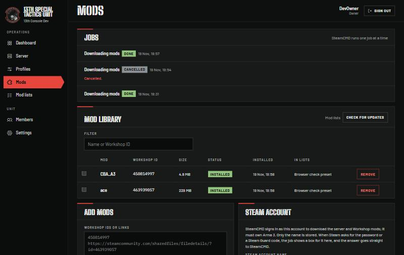
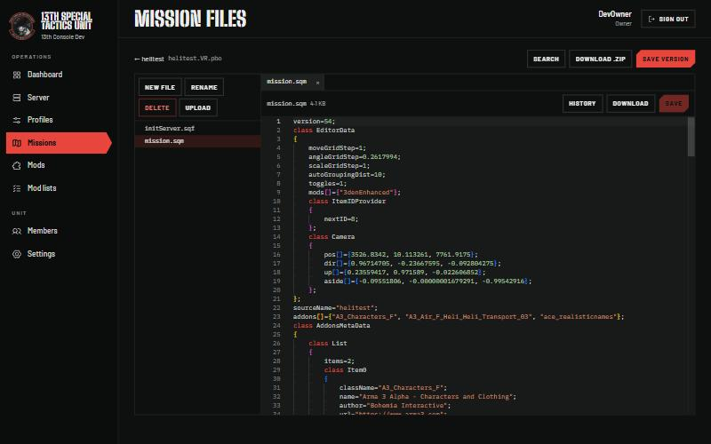

# 13th Console

Private, self-hosted web panel for the 13th Special Tactics Unit's Arma 3 server: accounts, missions, mods, server control and operations in one place.

**Status: Phase 7b (backups and schedules).**
- **Phase 1** brought invite-only accounts, roles with per-member overrides, two-factor sign-in, the audit log, announcements and the dashboard.
- **Phase 2** added the server agent: pairing, start/stop/restart/force-stop from the browser, live status checked through Steam A2S, the live server log, resource charts and the log files.
- **Phase 3** adds **Profiles**: editors for `server.cfg`, `basic.cfg` and the difficulty, with a raw editor beside each. Entries the forms don't know are kept as written. It also adds launch parameters with the full command line, mission rotation, difficulty presets, headless clients, revisions with compare and reset, and profile duplicate and compare.
- **Phase 5a** adds **Mods**: SteamCMD downloads Workshop mods and the dedicated server itself, mod lists (pasted IDs or an imported Launcher preset) set what each server loads, and Start deploys the mods' keys.
- **Phase 4a** adds **Missions**: a library with uploads, a browser editor, versions, and every saved version written onto the servers. It was built after 5a at the user's request.
- **Phase 5b** adds **Server missions**: the panel reads which addons and maps the server and every mod provide, lists the missions a mod list can run, and lets Zeus and mission makers start one themselves.
- **Phase 7b** adds **backups** (the console's database, uploaded missions and keys; each server's profiles, configs, missions and keys) with download, restore and keep-counts, and **schedules** that restart, update and back up on chosen days, never near an operation.
- **S-shop roles** replace the generic built-in roles with the unit's own (see **Roles** below); an existing console switches its members over once at startup.
- **Phase 7a** adds **RCon**: who's on, kick, ban and unban, messages to everyone, the ban list and an RCon log, through each server's BattlEye RCon; Stop now shuts the server down through RCon first.
- **Phase 6b** adds **notifications**: a bell in the console for what happened (operations announced, reminded, cancelled and ready; servers started and stopped; missions written; updates failed) and, if the unit wants, the same in a Discord channel through one webhook.
- **Phase 6a** adds **Operations**: plan an op (when, mission and version, server profile, mod list, Zeus, notes and briefing), see exactly what isn't ready, and apply it to its server in one confirmed step.
- **Phase 4b** adds **Files**: the server's own folders in the browser, each person only in the folders their permissions name, with a backup before anything is overwritten or deleted.

Still to come: diagnostics and the audit page (7c), and acceptance on the real box (Phase 8). See the [design](docs/superpowers/specs/2026-11-19-13th-console-design.md) and the plans for [Phase 1](docs/superpowers/plans/2026-11-19-phase-1-foundation.md), [Phase 2](docs/superpowers/plans/2026-11-19-phase-2-server-connection.md), [Phase 3](docs/superpowers/plans/2026-11-19-phase-3-profiles.md), [Phase 5a](docs/superpowers/plans/2026-11-19-phase-5a-mods.md), [Phase 4a](docs/superpowers/plans/2026-11-19-phase-4-missions.md) and [Phase 5b](docs/superpowers/plans/2026-11-20-phase-5b-server-missions.md), [Phase 4b](docs/superpowers/plans/2026-11-20-phase-4b-file-manager.md), [Phase 6a](docs/superpowers/plans/2026-11-20-phase-6a-operations.md), [Phase 6b](docs/superpowers/plans/2026-11-20-phase-6b-notifications.md) and [Phase 7a](docs/superpowers/plans/2026-11-20-phase-7a-rcon.md).

## Roles

The built-in roles are the 13th's staff sections. Each can still be edited on **Members → Roles**, and members can have their own grants and denies on top.

| Role | Who | Gets by default |
|---|---|---|
| Owner | head developer | everything |
| S1 | unit leadership | everything except pairing server agents |
| S2 | section leaders | the roster, operations (view and Prepare), join info, the mission library |
| S3 | mission makers and Zeus | missions (upload, edit their own, Start mission), the missions folder, operations (plan, Prepare, Apply), kick/ban, the live log |
| S4 | development | the server (start/stop, profiles, Apply, Arma updates), mods, mod lists and keys, every file folder, kick/ban and the RCon command box |
| S6 | sheets and bot infrastructure | the roster, join info, the mission library |
| S7 | trainers (FTXs) | operations (plan and Prepare), Start mission, the mission library |
| Member | everyone | server status, join info, the mission library, operations |

- **S1 and S4 look after the server.** Two-factor sign-in is optional for everyone; Settings can require it for chosen roles.
- **Switching an older console:** at its first start on this version, members of the old built-in roles move across (Server Administrator → S1, Mod Manager → S4, Mission Maker and Zeus → S3), the two-factor list follows, the old roles are deleted, and one `roles.switched` audit entry records who moved where (in its details, which the Audit page doesn't show yet). Edits made to the old roles' permissions aren't carried over; per-member grants and denies are.

## Profiles: save, apply, start

- **Save** makes a numbered revision and never touches the server.
- **Apply to server** (permission "Write profile settings onto the server") shows a diff of the files on the server, backs them up to the agent's `backups\profiles\<slug>\<time>\`, writes the head revision and checks the written files' hashes. It only works while the server is stopped: Arma rewrites its profile file when it exits.
- **Start** always launches the last *applied* revision, so a profile must be applied once before its first start. The server page says when saved changes aren't applied yet.
- **Passwords** (join, admin, server command) are stored encrypted and never shown again. Members with "See the server's join password" see the applied join password on the server page.
- **Raw editing:** typing a password into the raw editor or the extra-entries box stores it the same way.
- **Headless clients** start only beside a running server: automatically with "Start with the server", or from the server page. They join only missions with headless client slots; without one they run but never connect. Each writes its log to `profiles\<slug>\hc<n>\`.

## Mods

- **Steam account:** set its name on the **Mods** page. It must own Arma 3: the dedicated server (app 233780) and Arma's Workshop mods refuse an anonymous sign-in. Only the name is stored.
- **Signing in:** when SteamCMD asks for the password or a Steam Guard code, the job shows a box for it. The answer goes from the browser through the panel to SteamCMD's input and is never stored, logged or put on a command line; the job log masks it. SteamCMD then remembers the sign-in in its own `config` folder, so later jobs don't ask.
- **Library:** paste Workshop IDs or links, or import an Arma 3 Launcher preset (`.html`) under **Mod lists**. **Install missing** and **Update all** run SteamCMD jobs one at a time on the agent, with progress. **Check for updates** asks Steam for each mod's latest version and re-reads the agent's folders, which also adds local mods (folders copied into the agent's `localmods`).
- **Unlisted mods:** Steam's public lookup can't see them, so they're added as "Workshop item <id>" and take their name from their own files once downloaded. SteamCMD downloads them with the saved sign-in. Steam can't say when they change, so **Update all** fetches them every time ("+ N unlisted"). A private or removed mod fails its download with Steam's reason.
- **Mod lists:** each entry is a client mod (`-mod`), server only (`-serverMod`), headless (the headless clients' `-mod`) or optional (its key is allowed but nothing loads it). Lists export back to a Launcher preset.
- **Profiles** pick a list on their **Mods** tab; it's part of the revision, so it takes effect on **Apply**.
- **Start** copies the list's keys into the server's `keys` folder after backing the folder up to `backups\keys\`. **Server keys → Clean up keys** removes only keys of library mods that the chosen lists don't use; `a3.bikey`, Creator DLC keys and any key no library mod provides always stay.
- **Server files:** **Server → Setup → 3 · Server files** installs or updates the dedicated server (Public, Creator DLC or Profiling branch) into a registered install, even an empty one. Its servers must be stopped.



## Missions

- **A mission is `Name.Map`**, like `co10_Escape.Altis`; that is also its file name on the server. Names are unique, ignoring case.
- **Upload** a `.pbo`, a `.zip`, or a whole mission folder (dropped or picked), up to 200 MB. It's checked before anything is stored:
  - unsafe or duplicate file names;
  - zip bombs;
  - exactly one readable `mission.sqm`;
  - the `Name.Map` naming.

  An upload becomes a version and goes straight onto the servers (design Amendment A). An upload to an existing mission saves its next version.
- **Editing in the browser** (Monaco, with SQF and Arma config colouring): open, edit, create, rename, delete and upload files, and search across them.
  - A save made after someone else saved the same file is refused with a reload option.
  - Each file keeps its full history, with a diff against the current text.
  - Edits change only the working copy until **Save version**.
- **Binarized `mission.sqm`** (Eden's default) is shown as text, read-only. **Convert to text** makes it editable and keeps the original in the history. Arma reads either.
- **Versions** are immutable. Each version packs a PBO, reads it back to check it, and records the addons its `mission.sqm` requires, with the mod Eden recorded for each.
  - **Compare** two versions side by side.
  - **Restore** makes an older version current and writes it onto the servers again.
  - **Edit from here** loads a version into the working copy.
  - PBOs and the original uploads can be downloaded.
- **On the servers.** Every saved or restored version is written to every registered install's `mpmissions`:
  1. the agent pulls the PBO by hash and checks it;
  2. it backs up the file it replaces to `backups\missions\`;
  3. it swaps the new file in.

  A running mission holds its file open, so a version of it waits ("Waiting") and is written when the mission ends. An install listed in the agent's `ReadOnlyInstallRoots` is never written to; the mission page says so.
- **Permissions:**
  - `missions.view`, `missions.download` and `missions.create`;
  - `missions.editOwn` (the author and the collaborators they add);
  - `missions.editAny`.

  Archiving hides a mission and leaves the servers' files alone.



## Server missions

- **Scans.** The agent reads which addons (`CfgPatches`) and maps (`CfgWorlds`) the server install and every installed mod provide.
  - **When:** after a mod or the server is installed or updated, the first time the agent connects, and on **Rescan** (Mods page; Server → Setup).
  - **What's read:** only PBO headers and their `config.bin` / `config.cpp`, including compressed ones.
  - **Unreadable parts:** encrypted Creator DLC (`.ebo`), or a text config whose addon names are macros. These mark the mod or install **Partly scanned**, and the panel says which files. Nothing is guessed.
- **Server → Missions** lists the library missions written to that server, for a mod list.
  - **Default list:** the one the server runs.
  - **Listed:** a mission is listed when the server and the list's enabled **Client** or **Server only** mods provide every addon its `mission.sqm` needs, and its map. Extra mods don't hide anything. Optional and headless-only mods don't count, and neither does Creator DLC, which no profile loads yet.
  - **Couldn't confirm:** the gap could come from a mod that couldn't be fully read. These are listed with a warning.
  - **Doesn't match:** **Show missions that don't match** lists the rest, naming the missing map and addons, and which mod in the library has them.
- **Start mission** needs `missions.start`, which S1, S3, S4 and S7 hold. It's one action:
  1. it sets the server's rotation to that mission and its mod list to the chosen one;
  2. a running server is stopped first, since files can't be written while it runs;
  3. it applies;
  4. it starts the server.

  If the files can't be written after the stop, the server is started again with its previous settings, and the error says so. If it doesn't stop within 150 seconds, nothing is written.

  The confirmation says what will happen, including how many players a restart disconnects. It refuses a mission that doesn't match, and refuses if the player count changed since the confirmation. Nothing else on the profile changes, though changes an admin saved but didn't apply are applied too, and the confirmation says so.
- **The mission page's Mod lists panel** shows which lists can run the version each server has.

## Operations

**Operations** lists what's planned (Upcoming, Past and a month calendar, in your own time zone) and the dashboard shows the next five.

- **An operation** has a name, date and time, description, mission and pinned version (the map comes from the mission), server profile, mod list, mission maker, Zeus, mission notes and a player briefing.
  - Everyone who can see operations sees the briefing. Mission notes are only for people who can plan operations or run Prepare.
  - The briefing is plain text, shown with its line breaks.
  - Two people editing at once: the second save is refused and asks to reload.
- **Readiness.** **Prepare** checks every item of the unit's checklist now and stores the result with its time, so lists show "9 of 11 ready · checked 2 h ago", never a count nobody checked. Each item reads Ready, Not ready, Can't tell (the panel couldn't see it, for example the agent is offline) or Apply does this, with what's wrong and a link to where it's fixed.

  | Item | Ready when |
  |---|---|
  | Mission uploaded | a mission and version are chosen and the mission isn't archived |
  | Mission matches the mod list | the server and the list provide every addon and the map (Server missions) |
  | Mission version on the server | the pinned version is the one written to that server |
  | Server profile selected | chosen |
  | Mod list assigned and installed | every enabled mod in it is installed |
  | Workshop updates done | no mod has a newer Workshop version, Steam was asked about each in the last 24 hours (adding a mod or **Check for updates** asks it), and no download is running |
  | Mod keys on the server | every mod's key is in the server's keys folder (else Apply does this) |
  | Mission configuration checked | ticked by hand on the operation |
  | Mission rotation and mod list on the server | the server already runs just this mission with this list (else Apply does this) |
  | Server ready | the agent is connected, no SteamCMD job runs on the install, and the server is stopped or running |
  | Zeus assigned | at least one Zeus who isn't disabled |

  Settings → **Operations checklist** renames, reorders and switches items off, and adds manual items (`settings.manage`).
- **Apply to server** (`operations.apply`) checks again first and refuses while anything is Not ready or Can't tell, or a manual item is unticked. Then it does what Start mission does: sets the rotation to the operation's mission and the mod list, stops the server if it's running, applies, deploys keys and starts it, after a confirmation that says how many players a restart disconnects. Apply and Start mission take turns on one server.
- **Permissions:** everyone sees operations; S1, S3 and S7 plan them; S1, S2, S3 and S7 run Prepare; S1 and S3 apply them.
- **Deleting what an operation uses:** a server profile or mod list a planned operation uses can't be deleted until the operation uses another one. Done and cancelled operations keep their history.

## Players and RCon

The server page's **Players** tab talks to the running server through BattlEye RCon.

- **Who's on:** number, name, ping, how long they've been on (since they joined this run of the server, as far as the console has seen), and whether they're still in the lobby. Everyone who can see the server sees this.
- **With `players.manage`** (S1, S3 and S4 by default):
  - each player's BattlEye GUID and IP;
  - **Kick** and **Ban** (minutes, 0 for permanent, and a reason they see);
  - **Message to everyone**;
  - the **Bans** list with **Unban**;
  - the **RCon log**: BattlEye's own messages (logins, chat, kicks) and what admins did here, the last 500 lines per server, until the panel restarts.
- **Safe actions:** kick, ban and unban first re-read the list and refuse if that number no longer belongs to the same GUID, so they never land on whoever took the number since. Actions on one server run one at a time, so two quick unbans can't shift each other's numbers.
- **With `server.console` and `players.manage`** (S1 and S4), a command box takes only `players`, `bans`, `admins`, `missions`, `version`, `say`, `loadBans`, `writeBans`, `#lock` and `#unlock`. BattlEye would also take config lines over RCon; those are refused.
- **Stop** sends RCon `#shutdown` first, then closes the window and finally kills after the timeout, as before.
- **Setup:** nothing to set up.
  - Whenever a profile has BattlEye on, the agent writes BattlEye's `BEServer_x64.cfg` at each start, with RCon on `127.0.0.1` only, port = game port + 10, and a password the console makes and keeps encrypted (Profile → General → **New RCon password** replaces it from the next start).
  - The RCon port is never opened in the firewall, and profiles whose ports would collide with another profile's RCon port are refused.
  - With BattlEye off, the tab says RCon is off.

## Backups

**Backups** in the side bar (`backups.manage`: S1 and S4) makes and keeps two kinds of zip.

- **Console backup:** `console.db` (a consistent copy taken while the console runs), `blobs` (every uploaded mission file) and `keys` (without them a restored console can't read its saved passwords). Kept in `<data>\backups\console`.
  - The keys are locked to the Windows installation that made them. Restored on the same box, everything comes back.
  - Restored on a new or reinstalled box, everything comes back except the saved secrets. Set them again: each server profile's passwords (server, admin, RCon) and raw server.cfg lines, then Apply; and the Discord webhook. Everyone signs in again.
- **Server backup:** the agent's `profiles` (logs, persistence, BattlEye bans) and `configs`, and each install's `mpmissions` and `keys`. Mods and the Arma install aren't included; they re-download. Kept in the agent's `backups\server`.
- **When:**
  - by hand ("Back up the console / the server");
  - on a schedule;
  - automatically before every server update and every Workshop mod update.
- **Restore:**
  - **A server backup** writes the chosen parts back (server profiles, configs, missions folders, mod keys). Every server on that agent must be stopped. The current files are backed up first, and files added since are kept.
  - **A console backup** is restored on the box: stop the service, then run `Panel.exe restore <zip>` (the deploy guide's "Restoring the console").
- **Keeping:**
  - the newest 14 scheduled and 10 before-update backups of each kind are kept (Backups → Keeping backups);
  - backups made by hand or before a restore are only deleted by a person;
  - the automatic safety copies made before changes are deleted after 30 days (0 keeps them).
- **Copies elsewhere:** set `Backups:CopyTo` in the console's `appsettings.json` and `Agent:BackupCopyTo` in each agent's to another drive, a share or a synced folder; every zip is copied there too. They're set on the box, not in the browser, so nobody can point the agent at other folders.

## Schedules

**Schedules** in the side bar (`schedules.manage`: S1 and S4) runs tasks on chosen weekdays at a time in the **unit time zone** (Settings; `Australia/Sydney` by default).

- **Tasks:** restart, stop or start a server; update the server (SteamCMD, on the branch it was last updated on); update Workshop mods (check, then update those with updates); back up the console, a server or both.
- **Never near an operation:** a restart, stop, start or update is skipped from 2 hours before an operation until 4 hours after it starts. Backups still run.
- **Players:**
  - restarts and stops warn in game through RCon at 10, 5 and 1 minutes;
  - updates are skipped while anyone's on;
  - an empty running server is stopped, backed up, updated and started again.
- **Steam sign-in:** an update that needs your Steam sign-in fails with "Steam needs you to sign in; run one update by hand" instead of waiting.
- **Missed runs** (the console wasn't running at the time) are recorded, not run late.
- **History and notices:** each schedule keeps its run history; failed, skipped and missed runs notify S1 and S4 ("Scheduled task didn't run"). The dashboard shows the next three runs.

## Notifications

The bell in the title bar shows your own notifications: the latest 30, newest first, unread ones in bold. Clicking one opens what it's about. They're kept for 60 days.

You're told about what you can see: operations need "see operations", servers "see the server", missions "see missions", and failed downloads go to whoever could have answered the job.

| Event | When | Discord by default |
|---|---|---|
| New operation | an operation is planned | yes |
| Operation starting soon | the set number of minutes before it starts (60 by default; 0 turns it off) | yes |
| Operation cancelled | a planned operation is cancelled | yes |
| Operation ready to apply | Apply to server would be allowed for the first time (not again after unticking and ticking; again after an edit; never once applied) | no |
| Server started / stopped or went offline | a server process starts, or stops (an asked-for stop or a crash, which says so) | no |
| Mission written to a server | a mission version is written into a server's mpmissions | no |
| Update or download failed | a Workshop download or a server install/update fails (not a cancelled one) | no |

Settings → **Notifications** (`settings.manage`) turns each event on or off in the console and in Discord, and sets the reminder time.

- **Discord is optional:** paste a channel's webhook (in Discord: Server Settings → Integrations → Webhooks → New Webhook → Copy Webhook URL) and use **Send a test message**.
- **Only Discord's webhook address is accepted.** It's stored encrypted and never shown again: the page says Working, Last send failed or Not working.
- **A webhook Discord says is gone** (deleted or revoked) is marked Not working and not used again, not even by Send a test message, until it is pasted again (a new one, or the same one once fixed in Discord). A send that works clears an earlier "Last send failed".
- **What reaches Discord:** names, mission, map and times, shown in each reader's own time zone. Never mission notes, the briefing, join details or error text, and never a ping: `@everyone` and mentions are switched off.

## Files

**Files** shows the server's own folders. Pick the server and a folder set, then browse, search names, upload, download, open text files (UTF-8, up to 1 MB) in the editor, make folders, rename or move, copy, delete, and unzip `.zip` files.

| Folder set | Where | What can be written | Read / write permission | Given by default to |
|---|---|---|---|---|
| Missions folder | the install's `mpmissions` | anything but programs | `files.mpmissions.read` / `.write` | S1, S3, S4 |
| Mod keys | the install's `keys` | `.bikey` files only | `files.keys.read` / `.write` | S1, S4 |
| Server profiles | the agent's `profiles` (logs, BattlEye) | anything but programs | `files.profiles.read` / `.write` | S1, S4 |
| Local mods | the agent's `localmods` | anything | `files.localmods.read` / `.write` | S1, S4 |
| Generated configs | the agent's `configs` | read-only | `files.configs.read` | S1, S4 |
| Workshop mods | the agent's Workshop folder | read-only | `files.workshop.read` | S1, S4 |
| Backups | the agent's `backups` | read-only | `files.backups.read` | S1, S4 |

- **Passwords:** Server profiles (BattlEye's RCon config), Generated configs (`server.cfg`) and Backups hold server passwords. Give those folders only to people who may see them.
- **The agent decides:** where each folder set is, what may be written there, and that nothing passes through a junction or link. The install's own program files, `battleye` and DLLs are never reachable. "Programs" are `.exe`, `.dll`, scripts and the like; only Local mods may hold them, since mods carry DLLs.
- **Backups:** a delete or an overwrite first moves or copies the old item to the agent's `backups\files\<folder set>\<time>\`. A move, copy or unzip never overwrites. These copies are deleted after 30 days (Backups → Keeping backups).
- **Owners of the same files:**
  - **Library missions:** a mission PBO the library wrote can't be overwritten or renamed here; change it in the library. Deleting it is allowed and takes it off the Missions tab.
  - **Running servers:** a running server's own profile files (`<profile>\Users\…`, `*.Arma3Profile`) can't be changed until it stops; BattlEye's files can.
  - **Local mods:** a change in a local mod's folder sends it for a new addon scan.
- **Limits:** uploads up to 2 GB per file, text editing up to 1 MB, unzips up to 20,000 entries (the zip's own count, checked before it's opened) and 4 GB written, folder listings show the first 5,000 items and searches the first 500 matches or 5 seconds, both cut shorter if long names would make the reply too large for the agent's connection.
- **Who sees it:** the Files page and its folder list need at least one `files.*` read permission.
- **Audit:** every change is in the audit log as `file.*`.

## Requirements

- .NET 10 SDK (x64)
- Node.js 24

## Develop

Two processes: the panel (API and hubs, port 5080) and the Vite dev server (port 5173, proxies `/api` and `/hubs` to the panel).

```powershell
dotnet run --project src/Panel --launch-profile http
```

```powershell
npm run dev --prefix web
```

Open http://localhost:5173. In the Claude desktop app, the `panel` and `web` entries in the workspace `.claude/launch.json` start both.

Dev data lives in `data/` (gitignored): `console.db`, Data Protection `keys/`, and on first run `setup-token.txt`.

## First run

1. Start the panel. With no accounts yet, it writes a one-time setup token to `data/setup-token.txt` and prints it in the console.
2. Open `/setup`, paste the token, and create the Owner account.
3. Two-factor sign-in is optional (any authenticator app, from the account page). Settings can require it for chosen roles; then they must turn it on before doing anything else, and should save the recovery codes.
4. Invite members from **Members → Invites**: pick a role, copy the link, and paste it into a Discord DM. No email is sent.

## Tests

```powershell
dotnet test
```

`tests/Panel.Tests` covers setup, sign-in, lockout and rate limits, the role/permission matrix, per-member overrides and the escalation guard, invites, password resets, two-factor sign-in, announcements, activity, the audit log, agent pairing, profiles, server control and logs, the browser hub's access re-checks, mods (jobs and Steam prompts, the library, mod lists, preset import and export, launch arguments, keys), missions (uploads and their checks, the library, the working copy and its history, versions, deployments, agent blob pulls), and server missions (addon scans, compatibility, Start Mission). `tests/ArmaFormats.Tests` covers the PBO reader and writer, the binarized-config (raP) reader, text configs and the mission addon scan, all on missions built in code. `tests/Agent.Tests` drives the agent against `tests/FakeArmaServer` (a stand-in `arma3server_x64.exe`) and `tests/FakeSteamCMD` (a stand-in `steamcmd.exe` that asks for a password and Steam Guard codes, fails items and hangs on cue): path areas, the launch-argument allowlist, A2S, supervision and re-attach, the log tail, resources, file reads, SteamCMD jobs, the mod folders and keys.

## Publish

```powershell
npm run build --prefix web
```

```powershell
dotnet publish src/Panel -c Release -o publish
```

Run it from the publish folder, so `data/` is created next to the app:

```powershell
cd publish; .\Panel.exe --urls http://localhost:5080
```

In production the panel listens on `http://127.0.0.1:5080` only (`Urls` in appsettings.json) and trusts `X-Forwarded-For`/`-Proto` from loopback proxies, because members reach it through Caddy on a public domain with a Let's Encrypt certificate. It can run as a Windows service ("13th Console"); `data/` is then created next to the exe. Installing Caddy, DNS and both services on the server box is covered step by step in [Setting up 13th Console on the server](docs/deploy-windows-server.md). Outside localhost the sign-in cookie requires HTTPS.

## Server agent

`src/Agent` (`ConsoleAgent.exe`) runs on the machine with the Arma 3 server. It dials out to the panel's `/hubs/agent` (no inbound port), launches and supervises `arma3server_x64.exe`, checks it with Steam A2S, tails its RPT log and samples CPU, memory, disk and network. It never stops a server just because the agent or the panel restarts: it re-attaches by process id and start time.

Configuration lives in the agent's own `appsettings.json`, section `Agent` (the panel can show these paths but never change them):

| Key | Meaning |
|---|---|
| `PanelUrl` | The panel's address, e.g. `https://console.example.org` |
| `Key` | The key from **Server → Setup → Add agent** (shown once; **New key** issues another) |
| `InstallRoots` | Arma 3 server folders the agent may launch from, e.g. `["D:\\Arma3Server"]`. Empty = detect Steam libraries |
| `DataRoot` | Where the agent writes: `profiles\<slug>` (RPT logs, the server's `.Arma3Profile`, headless clients in `hc<n>`), `configs\<slug>` (the applied server.cfg / basic.cfg), `backups\profiles\<slug>` (copies made before each Apply), `backups\keys` (the keys folder before each key change), `backups\missions` (each mission file before it's replaced), `steamcmd` (SteamCMD and its saved Steam sign-in), `workshop` (Workshop mods) and `localmods` (mods you copy in yourself) |
| `ReadOnlyInstallRoots` | Install roots the agent may launch from but never writes into (missions, keys, SteamCMD installs). Empty on the server box |
| `SteamCmdPath` | Another `steamcmd.exe` to use. Empty = `<DataRoot>\steamcmd\steamcmd.exe`, downloaded from Valve on first use |
| `StopTimeoutSeconds` | How long a graceful stop waits before killing the server (default 60) |
| `QueryIntervalSeconds` | How often A2S is asked whether the server is up (default 5) |

Pairing:

1. In the panel, open **Server → Setup**, add an agent and copy its key.
2. Put the key in `Agent:Key` and the panel's address in `Agent:PanelUrl`.
3. Run the agent. The Setup page shows it as Connected within a few seconds. Then register the install it reports, create a profile under **Profiles**, and apply it.

Publish and run:

```powershell
dotnet publish src/Agent -c Release -o publish/agent
```

```powershell
cd publish/agent; .\ConsoleAgent.exe
```

Installing the agent as a Windows service on the server box, with Caddy and the domain, is in [Setting up 13th Console on the server](docs/deploy-windows-server.md). Its step 24 checks whether a graceful stop (`CloseMainWindow`) still works when the agent runs as a service in session 0; if it doesn't, stops fall back to the kill after `StopTimeoutSeconds` until RCon arrives in Phase 7.

Dev on this PC: `appsettings.Development.json` points at the K: test install (read-only) with `DataRoot` `D:\13th_server_dev`. The K: install is a client install with ReShade (`dxgi.dll`), which would write `ReShade.log` into K: from inside the server process, so start the dev agent from a shell with `$env:RESHADE_BASE_PATH_OVERRIDE = 'D:\13th_server_dev\reshade'`.
